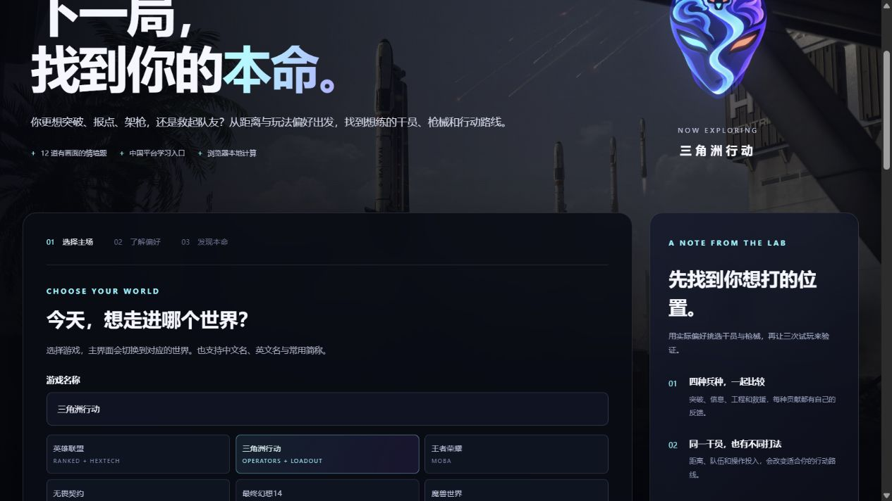

# 本命实验室 · MAIN LAB

从玩家偏好出发，探索想练的英雄、适合的位置和愿意尝试的玩法。输入游戏、完成 12 道情境题，获得能解释原因、可以实际试玩的建议。

**当前版本：0.4.0，开发中的玩家推荐工具。** 已有 [GitHub 仓库](https://github.com/KaynJ/main-lab) 和 [在线站点](https://kaynj.github.io/main-lab/)。新增三角洲行动的兵种、干员、打法和枪械报告；英雄联盟保留峡谷与海克斯双模式，其余五款游戏仍为基础玩法方向。提交并推送到 main 后自动部署，线上版本以 [Actions](https://github.com/KaynJ/main-lab/actions) 结果为准。

## 本地运行

需要 Node.js 20 或更新版本，无第三方运行依赖。

```sh
node launch.mjs
```

打开 [本地页面](http://127.0.0.1:4173/)。Windows 可双击根目录的 `启动本命实验室.cmd`。启动器会复用已运行的本命实验室服务，或启动后台服务；关闭启动窗口后仍可访问，电脑重启后需重新启动。启动问题见 `preview.stderr.log`。

`npm run preview` 与上述启动方式相同；`npm start` 使用前台服务，关闭终端后会停止。运行自动检查：

```sh
npm test
```

## 0.4.0 已实现

- **品牌与界面**：用户提供的本地头像，本命实验室 / MAIN LAB 名称，黑底白字，背景随所选游戏变化。
- **七款游戏**：英雄联盟、三角洲行动、王者荣耀、无畏契约、最终幻想14、魔兽世界、我的世界。支持中文、英文、常见简称与格式归一化，未知名称提示未收录。
- **图片问卷**：每轮 12 道题，覆盖协作、风险、节奏、贡献、探索、练习六个维度。三角洲使用专用情境题和官方图片，其他游戏沿用原问卷。
- **三角洲行动**：烽火地带优先，支持切换全面战场；四兵种、17 位干员、15 把枪械，结合交战距离、打法、练习投入、组队、平台与配装取向，提供解释、取舍、练习和原资料入口。S9、S10、S11 档案参考 ALWAYS聪聪本人 B站视频，保留枪管、套件和弹药条件，不把历史等级或未知平台评价套给当前选择。详见 [三角洲说明](docs/delta.md)。
- **可选 MBTI**：默认只作备注；三角洲可主动开启最多 ±1.5 分的干员排序参考。这是编辑假设，不改变枪械、距离或模式资格。英雄联盟和其他游戏仍只备注。
- **峡谷排位方案**：五个位置、20 位精选英雄，结合熟练度、操作投入、目标、组队、位置、玩法、地图关注与距离偏好，提供理由、摩擦点、练习和排位准备路线。切换位置后更新英雄与观摩对象。
- **海克斯大乱斗方案**：八位英雄、16 条流派，可查看推荐候选或选择实际随机到的英雄。每条路线提供强化属性方向、缺少联动时的备选、风险取舍与教学入口。乌迪尔包含 AP 觉醒 R“大招流”和物理 Q 穿甲方向。
- **两类观摩对象**：按位置分开推荐职业选手和主播。20 位峡谷英雄均有对应学习资源，其中 11 项为固定视频、九项为明确标注的搜索入口。视频与观摩链接使用 B站、抖音等中国平台。
- **报告与试玩**：查看预设示例、保留答案调整条件，下载所选游戏的 Markdown 报告。三角洲可在报告中切换模式，英雄联盟同时保留两种模式；短时用户会看到完整对局的时间限制。

原有六张背景、12 张题图和 22 张英雄小头像均为本地文件，出处见 [图片来源](docs/visual-sources.md)。三角洲另有 **30 张本地官方图片**：航天基地背景、12 张题图、17 张干员头像，出处见 [三角洲图片来源](docs/delta-visual-sources.md)。页面无需外部图片请求；学习资源的核查范围见 [英雄联盟资料](docs/lol-sources.md) 和 [三角洲枪械来源](docs/delta-weapon-sources.md)。

## 推荐方式与范围

问卷是**探索性自编题目**，不是标准 MBTI 测验或经过验证的心理量表。反向题转换后，每个维度取两题平均；推荐使用人工整理的玩法标签和确定性规则。三角洲可自选轻量 MBTI 编辑参考，默认不参与排序；规则分不代表胜率、段位、能力或人格百分位。

峡谷先考虑上手成本，再结合偏好、玩法、距离与地图负担排序，手动选择的位置优先。海克斯使用独立的英雄和流派标签，不套用峡谷分路。“优先寻找”指强化属性或机制方向，不保证某个海克斯当局出现。乌迪尔 R 是姿态技能，觉醒 R 也不能自动等同于所有强化描述中的“终极技能”。

三角洲优先匹配距离、操控与实际投入；手动兵种优先，干员学习成本影响首试候选。全面战场不使用烽火地带市场预算和榜单梯度；当期兵种枪池尚未核验，先在客户端确认可用枪械与解锁条件。作者未注明 PC / 手游的枪械评价只展示条件，不给任一端强度加分。

资料编辑日期为 2026-10-19。项目没有实时强度、胜率、账号解锁或排位准入接口；模式开放与实际机制以当前客户端为准。其他五款游戏尚未细化到具体英雄或职业。固定视频包含历史资料，搜索入口未被包装成已核验视频；目前核对的是公开资料，未逐条完整观看或保证所有用户均可播放。

问卷在浏览器本地计算，无账号、问卷上传、云端存储或分析埋点，刷新会清空答案。点击视频或资料时会打开相应平台。

## 主要文件

```text
web/index.html       页面结构与品牌
web/style.css        黑白主题、背景与响应式布局
web/app.js           游戏问卷、模式报告、下载与交互
web/model.js         名称识别、12 道题和基础推荐
web/lol.js           峡谷英雄、五位置和推荐规则
web/lol-media.js     中国平台资源与两类观摩对象
web/hextech.js       海克斯英雄、流派和独立规则
web/delta.js         三角洲专用问卷、推荐规则和报告
web/delta-operators.js 三角洲四兵种与17位干员
web/delta-weapons.js 三角洲15枪、赛季来源与变体范围
web/delta-visuals.js 三角洲背景、12题图和17干员头像
web/visuals.js       六款背景与12题图配置
web/assets/          本地头像、背景与情境插画
launch.mjs           后台启动、复用与就绪检查
server.mjs           仅绑定回环地址的静态服务器
test/                推荐、资料完整性与资源检查
docs/product.md      产品体验与当前边界
docs/lol-sources.md  英雄联盟媒体和机制来源
docs/delta.md        三角洲推荐规则与资料维护方法
```

## 预览与验证

自动检查包括输入校验、推荐场景差异、MBTI 边界、模式与赛季隔离、全部干员与枪械资料、图片完整性和报告导出。运行 `npm test` 查看当前结果；GitHub Pages 发布前也会运行测试。以下为已有界面预览，线上更新状态以 Actions 为准。



[三角洲干员推荐](docs/delta-report.png) · [手机预览](docs/delta-mobile.png) · [三角洲实际导出示例](docs/delta-sample-report.md)

[问卷配图](docs/main-lab-question.png) · [乌迪尔双流派](docs/main-lab-hextech.png) · [实际导出示例](docs/sample-report.md)

## GitHub 与部署

仓库为 [KaynJ/main-lab](https://github.com/KaynJ/main-lab)。已准备 GitHub Pages 自动部署配置：推送到 `main` 后先运行测试，再发布 `web/`。首次需要在仓库的 **Settings → Pages → Source** 选择 **GitHub Actions**，并上传工作流文件。完整步骤见 [部署说明](docs/deployment.md)。实际网址及上线状态以 GitHub Pages 和 Actions 结果为准。

本地启动器和服务器无需上传到静态托管服务。代码许可证尚未选择；游戏美术保留原权利人的版权，素材条件应独立于代码许可证记录。

下一步优先补充三角洲当期枪池与平台明确的原作者资料、真实试玩反馈，以及其他游戏的独立职业资料。逐季维护说明见 [三角洲说明](docs/delta.md)，整体设计见 [产品说明](docs/product.md)。
