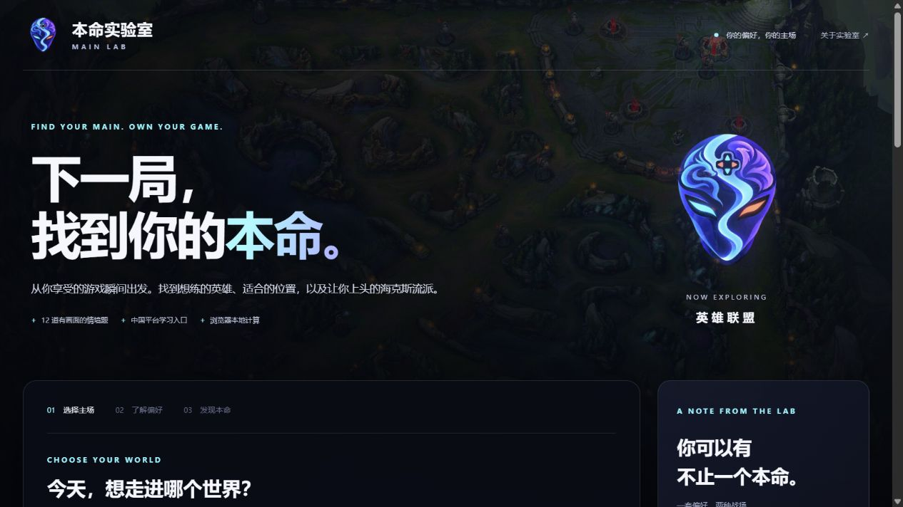

# 本命实验室 · MAIN LAB

从玩家偏好出发，探索想练的英雄、适合的位置和愿意尝试的玩法。输入游戏、完成 12 道情境题，获得能解释原因、可以实际试玩的建议。

**当前版本：0.3.0，本地原型，尚未发布到 GitHub。** 英雄联盟已有召唤师峡谷与海克斯大乱斗两部分报告；其余五款游戏仍提供基础玩法方向。

## 本地运行

需要 Node.js 20 或更新版本，无第三方运行依赖。

```sh
node launch.mjs
```

打开 [本地页面](http://127.0.0.1:4173/)。Windows 可双击根目录的 `启动本命实验室.cmd`。启动器会复用已运行的本命实验室服务，或启动后台服务；关闭启动窗口后仍可访问，电脑重启后需重新启动。启动问题见 `preview.stderr.log`。

`npm run preview` 与上述启动方式相同；`npm start` 使用前台服务，关闭终端后会停止。运行自动检查：

```sh
npm test
```

## 0.3.0 已实现

- **品牌与界面**：用户提供的本地头像，本命实验室 / MAIN LAB 名称，黑底白字，背景随所选游戏变化。
- **六款游戏**：英雄联盟、王者荣耀、无畏契约、最终幻想14、魔兽世界、我的世界。支持中文、英文、常见简称与格式归一化，未知名称提示未收录。
- **图片问卷**：12 道题各有一张本地情境插画，覆盖协作、风险、节奏、贡献、探索、练习六个维度。MBTI 可选填，只作备注。
- **峡谷排位方案**：五个位置、20 位精选英雄，结合熟练度、操作投入、目标、组队、位置、玩法、地图关注与距离偏好，提供理由、摩擦点、练习和排位准备路线。切换位置后更新英雄与观摩对象。
- **海克斯大乱斗方案**：八位英雄、16 条流派，可查看推荐候选或选择实际随机到的英雄。每条路线提供强化属性方向、缺少联动时的备选、风险取舍与教学入口。乌迪尔包含 AP 觉醒 R“大招流”和物理 Q 穿甲方向。
- **两类观摩对象**：按位置分开推荐职业选手和主播。20 位峡谷英雄均有对应学习资源，其中 11 项为固定视频、九项为明确标注的搜索入口。视频与观摩链接使用 B站、抖音等中国平台。
- **报告与试玩**：查看预设示例、保留答案调整条件，下载包含两种模式的 Markdown 报告。短时用户会看到完整对局的时间限制。

六张背景、12 张题图和 22 张英雄小头像均为本地文件，出处见 [图片来源](docs/visual-sources.md)。页面无需外部图片请求；媒体清单与核对范围见 [英雄联盟资料](docs/lol-sources.md)。

## 推荐方式与范围

问卷是**探索性自编题目**，不是标准 MBTI 测验或经过验证的心理量表。反向题转换后，每个维度取两题平均；推荐使用人工整理的玩法标签和确定性规则。MBTI 不参与排序，规则分不代表胜率、段位、能力或人格百分位。

峡谷先考虑上手成本，再结合偏好、玩法、距离与地图负担排序，手动选择的位置优先。海克斯使用独立的英雄和流派标签，不套用峡谷分路。“优先寻找”指强化属性或机制方向，不保证某个海克斯当局出现。乌迪尔 R 是姿态技能，觉醒 R 也不能自动等同于所有强化描述中的“终极技能”。

资料编辑日期为 2026-10-19。项目没有实时强度、胜率、账号解锁或排位准入接口；模式开放与实际机制以当前客户端为准。其他五款游戏尚未细化到具体英雄或职业。固定视频包含历史资料，搜索入口未被包装成已核验视频；目前只核对公开元数据，未逐条完整观看或保证所有用户均可播放。

问卷在浏览器本地计算，无账号、问卷上传、云端存储或分析埋点，刷新会清空答案。点击视频或资料时会打开相应平台。

## 主要文件

```text
web/index.html       页面结构与品牌
web/style.css        黑白主题、背景与响应式布局
web/app.js           问卷、双模式报告、下载与交互
web/model.js         名称识别、12 道题和基础推荐
web/lol.js           峡谷英雄、五位置和推荐规则
web/lol-media.js     中国平台资源与两类观摩对象
web/hextech.js       海克斯英雄、流派和独立规则
web/visuals.js       六款背景与12题图配置
web/assets/          本地头像、背景与情境插画
launch.mjs           后台启动、复用与就绪检查
server.mjs           仅绑定回环地址的静态服务器
test/                推荐、资料完整性与资源检查
docs/product.md      产品体验与当前边界
docs/lol-sources.md  英雄联盟媒体和机制来源
```

## 预览与验证

2026-10-19：32 项自动测试通过；浏览器实际走通六款背景切换、12 题完整作答、八位海克斯英雄的双路线、峡谷位置切换、国内媒体链接和报告下载。桌面与 390px 手机布局均检查过，无横向溢出。



[问卷配图](docs/main-lab-question.png) · [乌迪尔双流派](docs/main-lab-hextech.png) · [实际导出示例](docs/sample-report.md)

## GitHub 与部署

当前代码仍在本地，尚未创建或推送远程仓库。静态部署只需发布 `web/`，本地启动器和服务器无需上传到静态托管服务。代码许可证尚未选择；游戏美术保留原权利人的版权，素材条件应独立于代码许可证记录。

下一步优先补充试玩反馈、更多可核验的中文原作者教学，以及其他游戏的独立职业资料。详细设计见 [产品说明](docs/product.md)。
